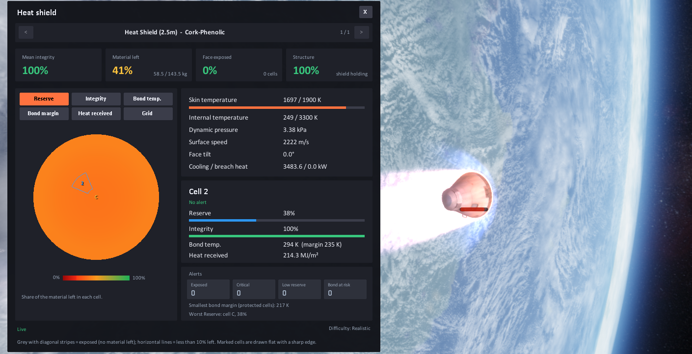

# RealTPS

***Made for every Kerbonaut who was ever toasted in the atmosphere.***

### Welcome to RealTPS

RealTPS (Real Thermal Protection Systems) is a Kerbal Space Program mod that reworks how heat shields work, going
for more realism. Instead of the one generic "Ablator" you get a catalogue of real thermal protection materials,
and a heat shield is no longer just a bar that drains: it wears unevenly, it can be breached and it can fail.

*A 2.5 m cork-phenolic shield coming back in. The shield window shows how much material is left in each cell, the
skin temperature against its limit, and the heat the burning cork is carrying away. I had Firefly and AVP
(Astronomer's Visual Pack) installed for the screenshot; RealTPS doesn't need them.*

#### Features

- **Real materials**: from cork to PICA, silica tiles and inflatable blankets, each one with its own mass, cost,
  temperature limits and way of failing.
- **Picked in the editor**: right-click a heat shield and choose what it's made of.
- **Unlocked through research**: you start with cork, and better materials come with the tech tree (stock or
  Community Tech Tree).
- **Wear where the heat hits**: the face of each shield is split into cells. The side facing into the flow, or the
  spot an engine is firing at, wears out first.
- **Breaches**: once a cell has nothing left, heat gets through to the part behind it.
- **Shield failure**: when the structure behind the breaches gives way, the shield loses its protection and the
  game's own heating does the rest.
- **Shield window**: a map of the shield face (material left, integrity, bond temperature, heat received) with
  exact alerts.
- **Works with planet packs**: RealTPS reads the game's own heating, so the longer, hotter entries of Real Solar
  System shouldn't need any special setting.
- **Difficulty options**: Friendly, Realistic, Strict or Custom, per save.

There's a lot more detail in the **[Wiki](docs/wiki/Home.md)**.

## Current version: 0.20.0

**Download**: GitHub releases or CKAN\
**Docs & support**: **[Wiki](docs/wiki/Home.md)** - GitHub issues\
**License**: [MIT](LICENSE)\
**KSP version**: 1.12.x\
**Requires**: [ModuleManager], [B9PartSwitch]\
**Optional**: [Community Tech Tree], Making History (adds the 1.875 m shield and the KV pods)

**[Mod compatibility](#mod-compatibility-and-support)** - [Changelog](CHANGELOG.md)

## Download and installation

**Install with CKAN, or grab the zip from the latest GitHub release.**

1. Back up your saves.
2. Copy `GameData/RealTPS` from the zip into your KSP `GameData` folder. If you have an older
   `GameData/KerbalAblativeMaterials` or `GameData/KerbalThermalProtectionSystems` folder, delete it first.
3. Make sure ModuleManager and B9PartSwitch are installed. Without them RealTPS does nothing, and a message tells
   you why.

The source code in this repository doesn't include the compiled plugin: use a release, or build it yourself
([CONTRIBUTING.md]).

Don't want the two speculative materials (the fictional intumescent composite and the theoretical Gen 3 blanket)?
Create an empty folder called `GameData/RealTPSNoSpeculative` and they're gone.

## Materials

RealTPS works on the stock heat shields, the three Making History pods and the stock inflatable heat shield. For
the details of each material, see **[Materials](docs/wiki/Materials.md)** and
**[Choosing a shield](docs/wiki/Choosing-a-shield.md)**.

**Ablators**: they burn away and take the heat with them.

| Material | What it is | Best for |
|---|---|---|
| Cork-Phenolic | Ground cork in resin, available from the start | Suborbital hops and low orbit |
| Phenolic-Fiberglass | The heat shield of the first capsules | Low orbit, steep Mun returns |
| Avcoat Honeycomb | The Apollo and Orion ablator | Mun returns, interplanetary returns of moderate mass |
| SLA-561V | A very light Mars-lander ablator | Gentle entries and thin atmospheres |
| Carbon-Phenolic | A dense carbon composite for the harshest entries | Anything, if you can carry the mass |
| SIRCA-15 | Light ceramic tiles, small shields only | Light probes coming back from orbit |
| PICA | A light carbon ablator | Light craft on fast returns |
| Conformal PICA (C-PICA) | A flexible PICA that fits curved pods | Light craft and the Making History pods |
| HEEET | Woven carbon made for giant-planet entries | Heavy capsules coming back from far away |
| Intumescent Composite *(fictional)* | A coating that swells into an insulating foam | Feather-light low-orbit protection |

**Reusable surfaces**: nothing burns; they glow and radiate the heat away.

| Material | What it is | Best for |
|---|---|---|
| LI-900 Silica Tile * | The Space Shuttle's tiles | Very gentle entries of very light craft |
| TUFROC * | A toughened carbon cap over insulation | Reusable low-orbit returns of light craft on large shields |
| Reinforced Carbon-Carbon * | The Space Shuttle's nose cap and leading edges | Like TUFROC, with a little more heat |
| UHTC (ZrB2-SiC) * | An ultra-high-temperature ceramic | The most heat a reusable surface takes; small shields only |

**Inflatable heat shield**: light protection spread over a huge area.

| Material | What it is | Best for |
|---|---|---|
| Ceramic-Cloth Blanket (Gen 1) | The basic blanket, available from the start | Light payloads from low orbit |
| Silicon-Carbide Blanket (Gen 2) | A blanket that takes more heat | Low orbit with more margin |
| Advanced Aerogel Blanket (Gen 3) *(theoretical)* | A projected blanket that has never flown | Low orbit with the most margin |
| Woven Carbon Fabric (ADEPT) * | Carbon cloth stretched over ribs | Faster entries than the blankets can take |

\* Placeholder part: see the notice below.

## Important notice

**Some materials sit on stock parts only so they aren't left unusable**: the LI-900 tiles, TUFROC, reinforced
carbon-carbon and UHTC on the stock heat shields, and the ADEPT fabric on the stock inflatable shield. In real life
they need parts with a different shape, look and construction, and those parts don't exist yet. They work fine in
the model; the part you see is just a stand-in ([Placeholder parts](docs/wiki/Placeholder-parts.md)).

**A note from me:** I'm not a 3D modeller. I'm doing my best to learn how to make these shields, and new parts
will come when I can make them properly. Until then, this is how it stays.

RealTPS is still young, and most of it has only been tested by me. If something looks wrong, please report it.

## Mod compatibility and support

- **Deadly Reentry: not compatible for now** (CKAN won't install both). Deadly Reentry turns the ablator of the
  stock heat shields and the Making History pods into its own heat shield module, and RealTPS doesn't remove it, so
  both mods end up handling the same part. Use one or the other until there's a compatibility patch.
- **Heat shields from other mods** aren't supported yet and keep their stock behaviour. Adding one is usually a
  single config entry, so pull requests are welcome ([Modding reference](docs/wiki/Modding.md)).
- **Planet packs and Real Solar System** should work without any special setting.
- **ReStock** works: a patch points RealTPS to ReStock's renamed inflatable heat shield animation.

## Documentation, help and bug reports

- **Player guide**: the **[Wiki](docs/wiki/Home.md)** covers how it works, every material, which one to use on
  which mission, and the shield window.
- **Found a bug?**
  - It might be another mod: check the compatibility list above.
  - Read **[Reporting problems](docs/wiki/Reporting-problems.md)** (logs, telemetry and the startup check).
  - Open a GitHub issue with the form that fits (bug, balance / realism, mod support, material, feature).
- **Want to contribute**, or add support for your mod?
  - Pull requests are welcome, especially configs for other mods' parts and translations (only English is
    required).
  - Read [CONTRIBUTING.md], which also explains how to build from source.
  - Where every material number comes from: `docs/sources/MATERIAL_SOURCES.md`.

## License

RealTPS is released under the [MIT license](LICENSE). It doesn't contain code, models or configs from any other
mod.

Before RealTPS, the mod was called Kerbal Ablative Materials and then Kerbal Thermal Protection Systems. Nothing
was ever released under those names.

[ModuleManager]: https://ksp.sarbian.com/jenkins/job/ModuleManager/lastStableBuild/
[B9PartSwitch]: https://github.com/KSPModStewards/B9PartSwitch
[Community Tech Tree]: https://github.com/post-kerbin-mining-corporation/CommunityTechTree
[CONTRIBUTING.md]: CONTRIBUTING.md
